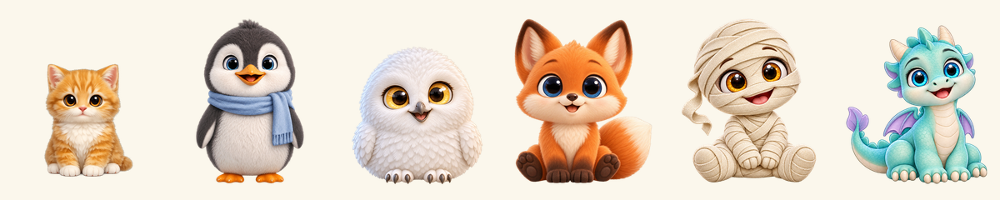
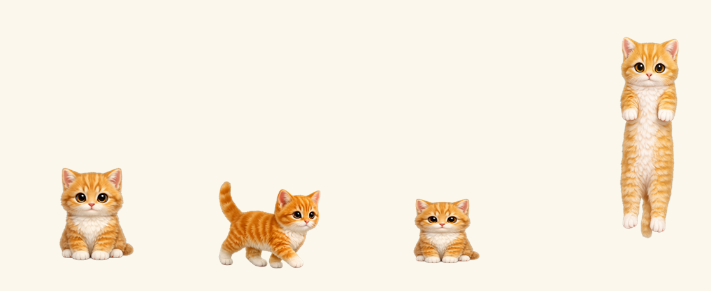

# 桌面猫 DesktopCat



一个 Windows 桌面宠物：双击就出现，会走、会坐、会睡、打字时踩奶、被拎起来会拉长、能站在任意窗口的顶边上。

单文件 exe（约 48 MB），不需要安装、不需要 Python、不需要运行库。所有素材内嵌在 exe 里。

## 下载

到 [Releases](../../releases) 页面下载最新的 `DesktopCat.exe`，双击运行。

> 首次运行 Windows 可能提示"已保护你的电脑" → 点 **更多信息 → 仍要运行**（程序没有代码签名证书）。

## 怎么玩



**第一次用就看这个 → [`docs/怎么玩.md`](docs/怎么玩.md)**（图文版，给小朋友和家长看的）

三步：双击 `DesktopCat.exe` → 右键它换角色 → 按住它拖到任意窗口的上边框，它就会站在上面。

| 动作 | 效果 |
|---|---|
| 右键点击 | 换角色、调大小、开关自己走动、开机自启、退出 |
| 按住拖动 > 8px | 拎起来（头始终跟手，身子垂下，不变形） |
| 拖到窗口上方松手 | 落在窗口顶边，会跟着窗口移动 |
| 打字 | 踩奶（有抬爪帧的角色会左右爪交替抬起） |
| 闲置 | 打哈欠、睡觉 |
| 走到屏幕边缘 | 顺着边缘爬到顶上，在顶上四脚朝上横爬，走到头顺着另一边爬下来（半路也会掉下来） |
| 鼠标移动 | 眼睛跟着鼠标看 |

## 自己编译

需要 **Windows + .NET Framework 4.x**（Win10/11 自带 `csc.exe`），无需装 SDK。

```powershell
# 1. 准备素材（仓库不包含美术资源，见下面的规格）
#    把 {角色}_{姿势}.png 放到 assets/
# 2. 编译
powershell -ExecutionPolicy Bypass -File build.ps1
# 3. 产物
#    DesktopCat.exe
```

`build.ps1` 会把 `assets/*.png` 全部以 `/resource:` 内嵌，源码只有 3 个文件（约 2500 行）：

| 文件 | 职责 |
|---|---|
| `src/CatPet.cs` | 窗口、状态机（坐/走/睡/拖/落/站窗口）、平台扫描、动画循环 |
| `src/SpriteArt.cs` | 贴图缩放与对齐、踩奶切帧、拉伸几何、眼神切换 |
| `src/Art.cs` | 角色表、中文名映射、资源发现 |

## 素材规格

素材不在本仓库（理由见「许可」）。要自己加角色，按这个规格出图：

- 每只角色 9 张，命名 `{name}_{pose}.png`
- pose ∈ `sit` / `sit_left` / `sit_right` / `sit_closed` / `sit_kneadA` / `sit_kneadB` / `walk` / `sleep` / `stretch`
- 1024×1024 PNG，真透明背景，四边留白 ≥60px
- 九张姿势里角色大小一致（头宽差 ≤8px），否则切姿势会跳
- 坐姿四张（sit/left/right/closed）必须严格同一画布、同尺度、脚底对齐
- `sit_kneadA/B` 只抬一只前爪，身体其它部分不许动（差异应 ≤12% 身体面积），否则程序会判定"整只重画"而回退成整只轻压
- `stretch` 是被拎起来的姿势：大头短身、四肢自然下垂

把素材放进 `incoming/{name}/` 后运行 `python tools/ingest2.py` 做统一裁切/对齐，再编译。

## 许可

- **代码**（`src/`、`tools/`、`build.ps1`）：MIT，见 [LICENSE](LICENSE)
- **美术素材**：不含在本仓库内，版权保留，不随 MIT 授权分发
- 仓库里的角色名、形象属于各自权利方

## 已知限制

- 只在 Windows 上跑（WinForms + GDI+）
- 走路是单帧贴图 + 上下起伏，不是逐帧动画
- 爬墙/天花板是把走路贴图按走向旋转（还没有专门画爬墙素材）
- 多显示器只支持主屏
