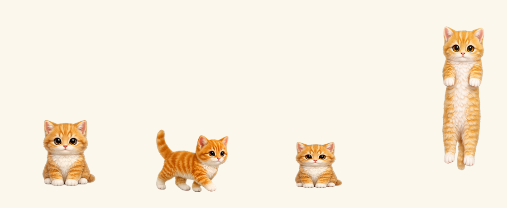

# 怎么玩（给小朋友和家长）

双击 `桌面猫.exe`，屏幕上就会多一只小猫。不用安装，不用登录，删掉 exe 就彻底没了。

---

## 一分钟上手

**第一步：双击 `桌面猫.exe`**

猫会出现在屏幕右下角，坐着。

> 如果 Windows 弹窗说"已保护你的电脑"，点 **更多信息** → **仍要运行**。
> 这不是病毒，是因为作者没有花 99 美元买微软的签名证书。程序不联网、不读你的文件。

**第二步：右键点它**

弹出菜单，第一项 **选择花色** 里可以换角色——一共 21 只（猫、狗、狐狸、企鹅、水豚、小蛇、雪鸮……）。

**第三步：按住它拖动**

按住（鼠标左键固定在猫身上不要松），**移动超过一点点距离**才会被拎起来——只是点一下不会触发。
拎起来的时候头跟着鼠标走，身子垂下来，**保持它本来的样子，不会被拉长变形**。

松手 → 它会掉下去，落在屏幕底部，或者落在别的窗口的上边框上。

**第四步：把它拖到任何一个窗口的上边缘**

比如浏览器、Word、微信的上边框，松手，它就**站在那个窗口上面**了。
那个窗口移动它也跟着走，窗口最小化它就掉到屏幕底部。

---

## 它自己会做的事

| 什么时候 | 它会做什么 |
|---|---|
| 你在打字 | 踩奶（两只前爪交替抬起来） |
| 你移动鼠标 | 眼睛跟着鼠标转 |
| 你不管它 | 待一会儿会打哈欠、趴下睡觉 |
| 它走到屏幕边上 | 会扒着屏幕边缘**一路爬到顶上** |
| 它在屏幕顶上 | 倒挂着横着走，走一会儿会**松手掉下来** |
| 你松手让它掉 | 往下坠，落到窗口上边或屏幕底部，落地时压扁一下再坐好 |

---

## 右键菜单（全部功能）

| 菜单项 | 作用 |
|---|---|
| **选择花色** | 换角色，21 只 |
| **大小** | 0.7x / 0.85x / 1.0x / 1.35x，默认 0.85x；调多大，拎起来也就是多大 |
| **自己走动** | 勾上它就会在屏幕底部来回走，不勾就一直坐着 |
| **开机自启** | 勾上，下次开电脑它自己出来 |
| **退出** | 关掉猫 |

> 找不到猫了？看屏幕右下角**系统托盘**（时间旁边的小箭头里），有个猫头图标，右键它也是同一个菜单。

---

## 常见问题

**杀毒软件说危险？**
因为没买签名证书。点"仍要运行"即可，或者在杀软里把它加进白名单。源码全部公开在 GitHub 上，可以自己编译。

**会让电脑变卡吗？**
不会。它只占几十 MB 内存，不联网，不读写你的文件，只在需要的时候画一帧。

**怎么彻底删掉？**
关掉猫 → 把 exe 删掉 → 打开 `C:\Users\你的用户名\AppData\Roaming\DesktopCat`，删掉那个文件夹（存的是选的角色和大小设置）。

**它会挡住我点东西吗？**
不会。猫窗口里透明的部分鼠标能直接点穿，只有猫身上那一小块会接住鼠标。它也碰不到任何窗口里的内容。
